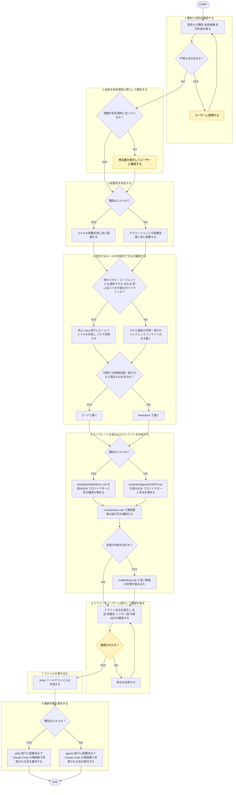

# create-skill

## 概要

本リポジトリのルール（命名規則・配置先・テンプレート）沿い、スキルまたは
サブエージェントのファイル対話的に生成。

## 参照するルール・テンプレート

| 用途 | パス |
|------|------|
| 命名規則 | `shared-rules/naming-conventions/naming-rule.md` |
| 配置ルール | `shared-rules/repository-structure/structure-rule.md` |
| テンプレートルール | `shared-rules/template/template-rule.md` |
| ルール外部化原則 | `shared-rules/rule-externalization/externalization-rule.md` |
| ハーネス制御の媒体選択 | `shared-rules/harness-engineering/harness-rule.md` |
| プロンプト構成要素 | `shared-rules/prompt-engineering/composition-rule.md` |
| 推論の足場の要否 | `shared-rules/prompt-engineering/scaffolding-rule.md` |
| プロンプト頑健性・安全性 | `shared-rules/prompt-engineering/robustness-rule.md` |
| レビュー重大度の共通定義（レビュー系のみ） | `matagi/shared-rules/review-severity/severity-rule.md` |
| スキルテンプレート | `template/skills/SKILL.md` |
| エージェントテンプレート | `template/agents/AGENT.md` |

## 手順



遷移は図、判定基準・詳細は下の本文に従う。

凡例: 黄 = ユーザーの確認・承認

### 1. 種別と目的を確認する

ユーザー発言から以下を読み取る。不明→質問。

- **種別**: スキル or サブエージェント
- **名前（候補）**: ユーザー挙げた名前、または目的から導出
- **目的**: 何をするか（1〜2行）

### 2. 名前を命名規則に照らして確定する

`shared-rules/naming-conventions/naming-rule.md` に従う。

| 種別 | 形 | 例 |
|------|----|----|
| スキル（タスク系） | 動詞・命令形 | `deploy`, `create-skill` |
| スキル（知識系） | 名詞句 | `api-conventions` |
| サブエージェント | 役割名詞 | `code-reviewer`, `docker-expert` |

- kebab-case 必須
- `helper`, `stuff`, `my-skill-v2` 等は不可
- ユーザー候補が規則不適合→修正案提示後に確認

### 3. 配置先を決定する

`shared-rules/repository-structure/structure-rule.md` に従う。

| 種別 | 配置先 |
|------|--------|
| スキル | `plugins/matagi/skills/<name>/SKILL.md` |
| サブエージェント | `plugins/matagi/agents/<name>.md` |

### 4. 内包するルールを外部化できるか確認する

`shared-rules/rule-externalization/externalization-rule.md` に従い、スキル・エージェントに書くルール・制約・判断基準 `rules/` へ切り出せるか判断。

- **切り出す**: 他スキル・エージェントにも適用可、または「常に従うべき不変のガイドライン」性質のもの
- **インラインのまま**: そのスキル固有の手順・実行ロジック

切り出す場合 先に `rules/<topic>/` にルールファイル作成、スキル・エージェントからパス参照。

また `shared-rules/harness-engineering/harness-rule.md` に従い、スキル付随の自動化・制御処理の媒体を判断。

- **コード（`.sh` / `.ts` / `.js`）**: 「破られたら困る」制御（パーミッション、フック実行ロジック、リトライ）
- **Markdown（`.md`）**: モデルへのソフトな指針（方針、規約、トーン）

### 5. テンプレートを読み込んでドラフトを作成する

#### スキルの場合

`template/skills/SKILL.md` を読み込み、以下を埋める。

```yaml
---
name: <確定した名前>
description: >
  <ユーザーが自然に言う言葉（トリガー語）を先頭に。要点を先頭に>
# when_to_use: （任意）
# allowed-tools: （任意）
# disable-model-invocation: true  （副作用ありのタスク型を手動起動のみにしたい場合）
---
```

本文構成（概要／ルール／手順／出力・500行未満）と手順の記述形式（mermaid `flowchart TD`）は [[template-rule]] (`shared-rules/template/template-rule.md`) を唯一の出典とする。テンプレート構成そのまま埋める。構成を独自に定義し直さない。Step 4 で外部化したルールあり→`## ルール` 節に参照記載、なし→節ごと削除。

description・手順・出力など指示文を書くとき、[[composition-rule]] (`shared-rules/prompt-engineering/composition-rule.md`) の構成要素が揃っているか確認。多段判断を含むスキル・エージェント→[[scaffolding-rule]] (`shared-rules/prompt-engineering/scaffolding-rule.md`) に従い推論の足場を組み込む（単純タスクには足さない）。

#### サブエージェントの場合

`template/agents/AGENT.md` を読み込み、以下を埋める。

```yaml
---
name: <確定した名前>
description: <委譲条件を具体的に。いつ・何を・どう返すかを明示>
# tools: （任意。省略で全ツール継承）
# model: （任意。haiku でコスト最適化など）
---
```

本文=「役割宣言 → 手順 → チェックリスト/観点 → 出力フォーマット」職務記述書スタイル。手順の記述形式（mermaid `flowchart TD`）は [[template-rule]] を唯一の出典とする。

### 6. ドラフトをユーザーに提示して確認を取る

作成予定ファイル内容を全文提示、以下を確認。

- 名前・配置先は正しいか
- description のトリガー語は自然か
- 手順・出力フォーマットは意図通りか

修正があれば反映して再提示。

### 7. ファイルを書き込む

承認後、Write ツールでファイル作成。

### 8. 後続作業を案内する

**スキルを作成した場合:**

```
skills/ 配下に配置済みです。Claude Code を再起動すると反映されます。
発火精度や出力品質を測りたい場合は evaluate-skill で評価できます（任意）。
```

**サブエージェントを作成した場合:**

```
agents/ 配下に配置済みです。Claude Code を再起動すると反映されます。
```

## 出力

- 確認フェーズ: ドラフト全文（フロントマター＋本文）
- 完了フェーズ: 作成したファイルのパスと後続手順
