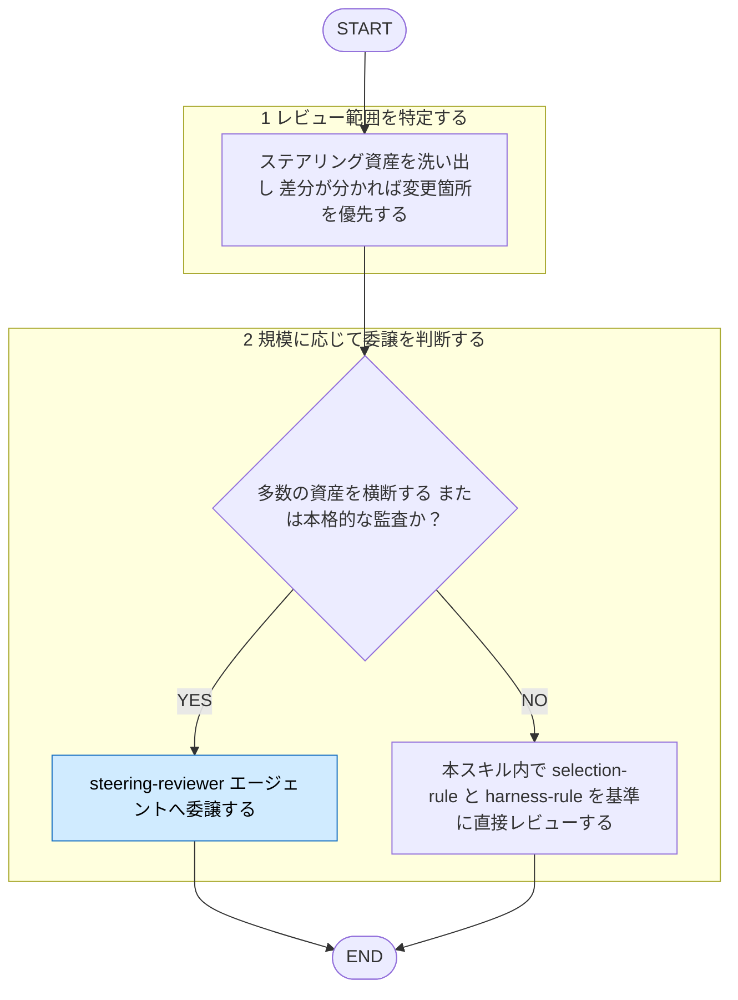

# harness-review

役職: **オキテ**（検証者）。手法選択の逸脱見逃さぬ。

## 概要

ステアリング構成レビューの**入口**タスクスキル。監査は `steering-reviewer` エージェントへ
委譲。プロジェクトの Claude Code カスタマイズ資産（AGENTS.md/CLAUDE.md・`rules/`・`skills/`・`agents/`・
hooks・output styles）を各手法の公式の意図に照らし、手法の誤用・逸脱を
Critical / Warning / Suggestion で指摘。**指摘までが責務**。改善の適用は行わない。

判断の土台は `documents/reference/harness-engineering/steering-claude-code.md`（7手法の意図）。

> プロンプト品質・コンテキスト設計も含め横断レビューしたいなら `ai-engineering-review`。

## ルール

- どの手法を使うべきかは [[selection-rule]] (`shared-rules/harness-engineering/selection-rule.md`) に照らす。
- コードで強制すべきか md でよいかは [[harness-rule]] (`shared-rules/harness-engineering/harness-rule.md`) に照らす。
- 手法ごとの挙動・事実は [[steering-claude-code]] (`documents/reference/harness-engineering/steering-claude-code.md`) 参照。

## 手順

遷移は図、判定基準・詳細は下の本文に従う。

凡例: 青 = 他スキル・エージェントへの委譲

### 1. レビュー範囲を特定する

対象プロジェクトのステアリング資産を洗い出す：ルート/サブディレクトリの AGENTS.md / CLAUDE.md、
`.claude/rules/`（`rules/`）、`.claude/skills/`、`.claude/agents/`、
`settings.json` の hooks、`.claude/output-styles/`。差分が分かるなら変更箇所を優先。

### 2. 規模に応じて委譲を判断する

- **多数の資産を横断／本格的な監査**: `steering-reviewer` エージェントへ委譲
  （多資産を読み込み所見を構造化して返す役割）。
- **単一ファイル・少量の差分**: このスキル内で直接レビュー。その場合も基準は
  [[selection-rule]] / [[harness-rule]]、事実は [[steering-claude-code]]。

エージェントへ「レビュー対象ファイル／差分」と「指摘のみ・修正は適用しない」旨を渡す。

## 出力

優先度ごとに整理して指摘を返す。**修正の適用は行わない**。

3段階（Critical / Warning / Suggestion）の定義は [[severity-rule]]（`matagi/shared-rules/review-severity/severity-rule.md`）に従う。このドメインの Critical 該当例: 保証されるべき制御が散文頼みなど、破られると困る誤配置。

各項目は 箇所 ／ 逸脱した手法選択（根拠ルールのパス）／ 問題点 ／ あるべき置き場所 の形。
逸脱なしなら「各手法の意図に準拠、問題なし」と明記する。
