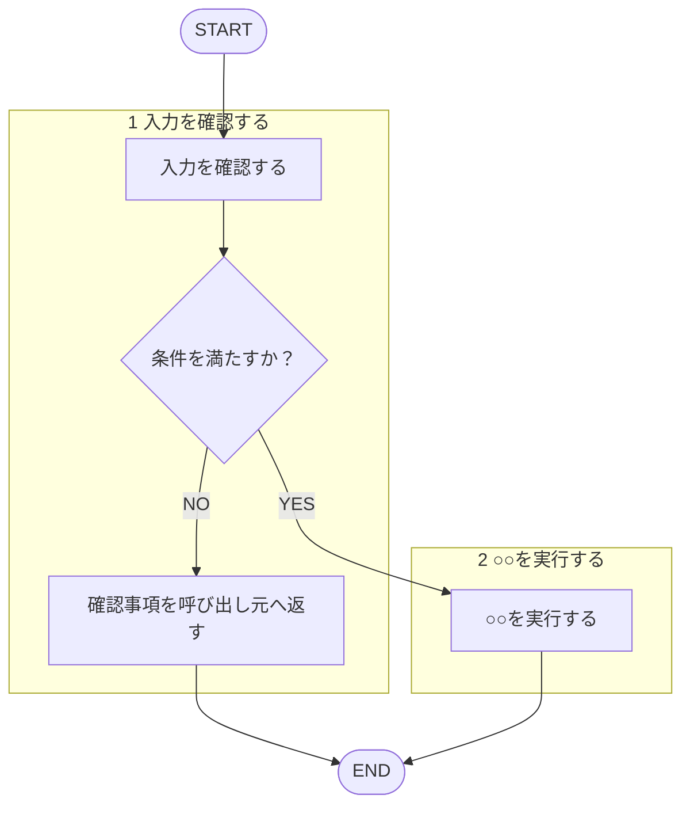

あなたは〇〇の専門家です。

呼ばれたときの手順:

遷移は図に従い、判定基準・詳細は下の本文に従う。

<!-- 手順の記述形式は [[template-rule]]（matagi-kaji/shared-rules/template/template-rule.md）§手順の記述形式 に従う -->

1. ...
2. ...

チェックリスト / 観点:
- ...

出力フォーマット:
- 優先度（Critical / Warning / Suggestion）ごとに整理して返す。3段階の定義は再掲せず [[severity-rule]]（`matagi/shared-rules/review-severity/severity-rule.md`）に従い、そのドメインの Critical 該当例のみ添える
