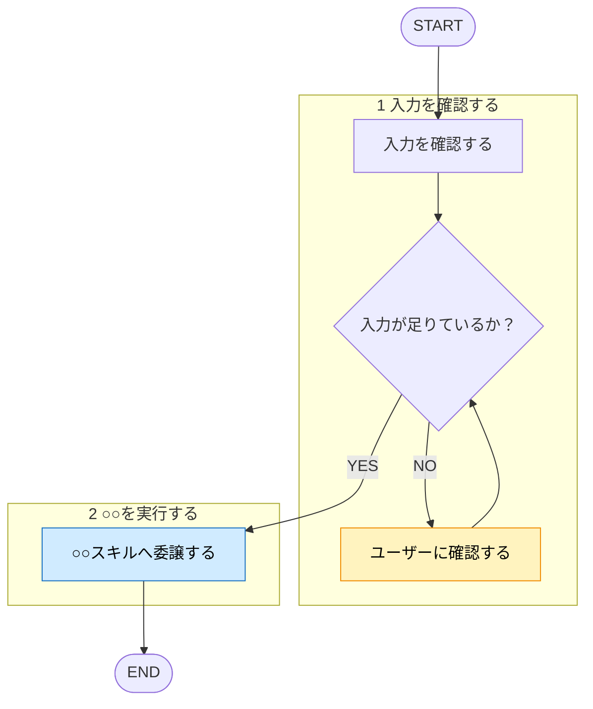

# スキルタイトル

## 概要
（1〜2行。何をするスキルか）

## ルール

<!--
このスキルが従う規約・判断基準・禁止事項は、ここに直接書かず参照する。
- 他スキルにも効く / 不変のガイドライン → rules/<topic>/ に切り出して [[name]] で参照
- このスキル固有だが長い → skills/<name>/reference/ に切り出して参照
- 短いスキル固有の判断 → 手順内にインライン可
判断基準は shared-rules/rule-externalization/externalization-rule.md に従う。
ルールが無いスキルなら、この節ごと削除してよい。
-->

- 〇〇は [[xxx-rule]] (`rules/<topic>/xxx-rule.md`) に従う。
- △△は [[yyy-rule]] (`rules/<topic>/yyy-rule.md`) に従う。

## 手順

遷移は図に従い、判定基準・詳細は下の本文に従う。

凡例: 黄 = ユーザーの確認・承認、青 = 他スキル・エージェントへの委譲

<!-- 手順の記述形式は [[template-rule]]（matagi-kaji/shared-rules/template/template-rule.md）§手順の記述形式 に従う -->

1. ...
2. ...

## 出力
（Claude がユーザーに返す内容の形式）
