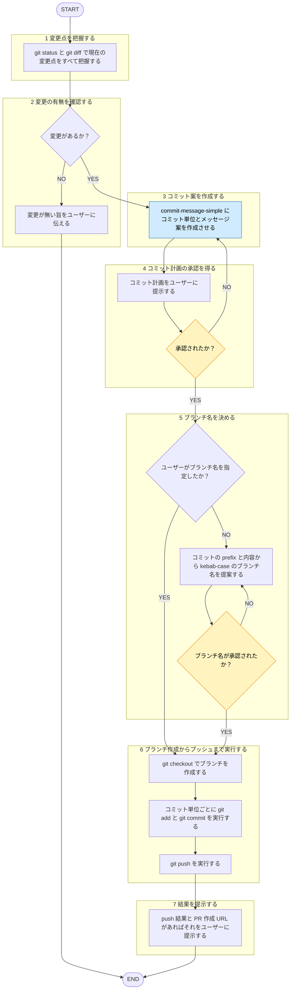

# branch-and-push

## 概要
未コミット変更を、ブランチ作成→コミット→pushまで一連で進行。コミットメッセージ・分割は commit-message-simple スキルへ委譲。

## ルール

- コミット単位・メッセージのフォーマットは [[commit-message-simple]] (`skills/commit-message-simple/SKILL.md`) の出力に従う。本スキルで独自にメッセージを組み立てない。
- push・ブランチ作成・コミットはいずれも取り消しに手間がかかる、または外部公開される操作。実行前に必ずユーザーの承認を得る。本スキルは各操作前に確認を挟む対話型フロー。無断の自律実行は不可。ユーザーから「確認なしで進めて」等の明示指示がある場合を除き、無断で進めない。

## 手順

遷移は図に従い、判定基準・詳細は下の本文に従う。

凡例: 黄 = ユーザーの確認・承認、青 = 他スキル・エージェントへの委譲

1. `git status` と `git diff`（未追跡ファイルは内容確認）で現在の変更点をすべて把握。
2. 変更なしなら、その旨をユーザーに伝えて終了。
3. 変更内容を commit-message-simple スキルに渡し、コミット単位（ファイル構成）とメッセージ案を作成させる。ユーザーが「このコミットだけ」等で対象を絞った場合は反映。
4. commit-message-simple の手順に従い、コミット計画（ファイル構成・メッセージ）をユーザーに提示、承認を得る。
5. ブランチ名を決定。ユーザー指定がなければ、承認済みコミットの prefix と内容から kebab-case のブランチ名を1つ提案（例: `docs/xxx-rule`, `fix/yyy-bug`）、確認を取る。
6. 承認を得たら以下を順に実行。
   - `git checkout -b <branch>`
   - 承認済みコミット単位ごと: `git add <files>` → `git commit -m "..."`
   - `git push -u origin <branch>`
7. push結果（リモートブランチ名、GitHub 返却の PR 作成 URL があればそれ）をユーザーに提示。

## 出力

- 確認フェーズ: コミット計画（commit-message-simple の提案）とブランチ名案
- 完了フェーズ: 作成ブランチ名、実行コミット一覧、push結果（PR作成URL等）
