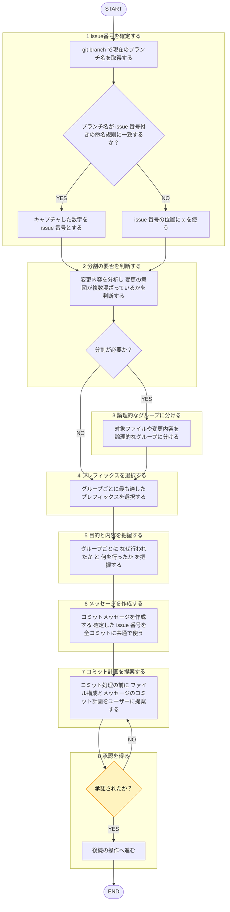

# 目的

ユーザー提供の変更内容・指示をもとに、一貫フォーマットの日本語コミットメッセージを生成。複数の異なる意味を持つ変更が含まれる場合は、論理的な単位に分割して提案。

# コミット分割のルール

- 1コミット = 1つの論理的変更のみ（例：「機能追加」と「無関係なバグ修正」、「リファクタリング」と「機能追加」などは分ける）。
- 変更点（diff）に複数の意図が混在する場合、プレフィックスごとにコミットを分割。

# フォーマット

各コミットメッセージは以下の形式に厳密に従う。

`#<issue番号> <prefix>: <○○>のため<△△>する`

- `#`: 固定リテラル文字。issue番号の有無に関わらず必ず先頭に付ける。
- `<issue番号>`: 現在のブランチ名から抽出した issue 番号（数字）。抽出不可なら `x`。手順は下記「issue番号の取得」。
- `<prefix>`: 下記プレフィックス一覧から適切なものを一つ選択。
- `<○○>`: 変更の「目的」「理由」を簡潔に記載。
- `<△△>`: 具体的な変更の「内容」「手段」を簡潔に記載。

例:
- 抽出できた場合: `#51 feat: ユーザー管理のためログイン機能を追加する`
- 抽出できない場合: `#x fix: 表記揺れ解消のためラベルを修正する`

## issue番号の取得

- `git branch --show-current` で現在のブランチ名を取得。
- ブランチ名の命名規則は [[issue-driven-rule]]（`shared-rules/issue-driven-development/issue-driven-rule.md`）を唯一の正とし、本節で再掲しない。**issue-driven-rule のブランチ命名規則（区切り文字・順序）を変更する場合、下記抽出手順も合わせて更新必須。**
- 抽出手順: ブランチ名が正規表現 `^[^/]+/#(\d+)_` に一致すれば、キャプチャした数字を issue 番号とする。
- 不一致（`#` が無い、`#` 直後が数字でない、`_` 区切りが無い等、境界ケースをすべて含む）は、issue番号の位置に `x` を使う。

# プレフィックス一覧

- `feat`: 新しい機能を追加
- `fix`: バグ修正
- `refactor`: コードのリファクタリング
- `style`: コードの見た目やフォーマットを修正 (機能に影響なし)
- `test`: テストコードの追加や修正
- `docs`: ドキュメントの修正や追加
- `chore`: ビルドやツール関連の変更
- `remove`: ファイルや機能の削除
- `rename`: ファイル名の変更

# 指示

遷移は図に従い、判定基準・詳細は下の本文に従う。

凡例: 黄 = ユーザーの確認・承認

1. `git branch --show-current` で現在のブランチ名を取得、「issue番号の取得」の手順で issue番号（または `x`）を確定。
2. 対象の変更内容（diffや説明）を分析し、変更の意図が複数混在していないか（分割すべきか）判断。
3. 分割が必要なら、対象ファイル・変更内容を論理的なグループに分ける。
4. グループごとに最適なプレフィックスを選択。
5. グループごとに、変更が「なぜ行われたか（○○）」と「何を行ったか（△△）」を把握。
6. `#<issue番号> <prefix>: <○○>のため<△△>する` 構成の1行メッセージを作成。手順1で確定した issue番号（または `x`）を全コミット共通で使う。
7. 分割の有無に関わらず、**必ず実際のコミット処理の前**に、「どのファイル構成で、どのコミットメッセージにするか」のコミット計画を日本語でユーザーに提案。
   - 提案フォーマットの例:
     - コミット1（対象ファイル: `A.ts`, `B.ts`）
       - メッセージ: `#51 feat: ユーザー管理のためログイン機能を追加する`
     - コミット2（対象ファイル: `C.css`）
       - メッセージ: `#51 style: 視認性向上のためボタンの色を変更する`
8. ユーザーから構成提案への承認（OKなど）を得た後にのみ、後続の操作（`git commit` コマンドの提示・実行など）へ進む。
