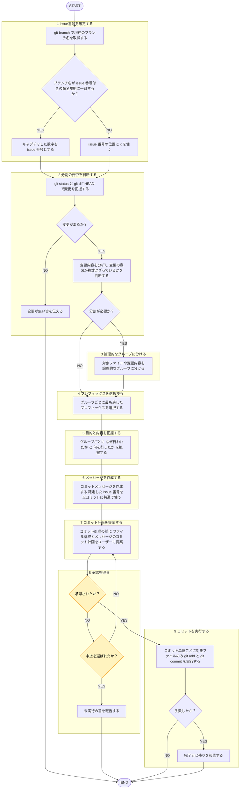

# 目的

`git status`・`git diff`・ユーザー指示→一貫フォーマット日本語コミットメッセージ生成。複数の異なる意味持つ変更含む場合 = 論理的単位に分割して提案。承認後 `git add`・`git commit` 実行。push 対象外。

# コミット分割のルール

- 1コミット = 1つの論理的変更のみ（例：「機能追加」と「無関係なバグ修正」、「リファクタリング」と「機能追加」などは分ける）。
- 変更点（diff）に複数意図混在 → プレフィックスごとコミット分割。

# フォーマット

各コミットメッセージ = 以下形式に厳密に従う。

`#<issue番号> <prefix>: <○○>のため<△△>する`

- `#`: 固定リテラル文字。issue番号有無に関わらず必ず先頭に付ける。
- `<issue番号>`: 現ブランチ名から抽出した issue 番号（数字）。抽出不可 → `x`。手順 = 下記「issue番号の取得」。
- `<prefix>`: 下記プレフィックス一覧から適切なもの一つ選択。
- `<○○>`: 変更の「目的」「理由」を簡潔記載。
- `<△△>`: 具体的な変更の「内容」「手段」を簡潔記載。

例:
- 抽出できた場合: `#51 feat: ユーザー管理のためログイン機能を追加する`
- 抽出できない場合: `#x fix: 表記揺れ解消のためラベルを修正する`

## issue番号の取得

- `git branch --show-current` で現ブランチ名取得。
- ブランチ名命名規則 = [[issue-driven-rule]]（`shared-rules/issue-driven-development/issue-driven-rule.md`）を唯一の正とし、本節再掲しない。**issue-driven-rule ブランチ命名規則（区切り文字・順序）変更する場合、下記抽出手順も合わせて更新必須。**
- 抽出手順: ブランチ名が正規表現 `^[^/]+/#(\d+)_` に一致 → キャプチャ数字 = issue 番号。
- 不一致（`#` 無し、`#` 直後が数字でない、`_` 区切り無し等、境界ケースすべて含む）→ issue番号位置に `x` 使用。

# プレフィックス一覧

- `feat`: 新機能追加
- `fix`: バグ修正
- `refactor`: コードリファクタリング
- `style`: コード見た目・フォーマット修正 (機能影響なし)
- `test`: テストコード追加・修正
- `docs`: ドキュメント修正・追加
- `chore`: ビルド・ツール関連変更
- `remove`: ファイル・機能削除
- `rename`: ファイル名変更

# 指示

遷移は図に従い、判定基準・詳細は下の本文に従う。

凡例: 黄 = ユーザーの確認・承認

1. `git branch --show-current` で現ブランチ名取得 → 「issue番号の取得」手順で issue番号（または `x`）確定。
2. `git status`・`git diff HEAD`（未追跡ファイル = 内容確認）で変更把握。変更なし→その旨伝え終了。ユーザー「このコミットだけ」等で対象絞った場合は反映。対象変更内容を分析 → 変更意図が複数混在していないか（分割すべきか）判断。
3. 分割必要 → 対象ファイル・変更内容を論理的グループに分ける。分割粒度 = ファイル単位（同一ファイル内分割 対象外）。
4. グループごと最適プレフィックス選択。
5. グループごと、変更が「なぜ行われたか（○○）」「何を行ったか（△△）」把握。
6. `#<issue番号> <prefix>: <○○>のため<△△>する` 構成の1行メッセージ作成。手順1で確定した issue番号（または `x`）を全コミット共通で使う。
7. 分割有無に関わらず、**必ず実際のコミット処理の前**に、「どのファイル構成で、どのコミットメッセージにするか」のコミット計画を日本語でユーザーに提案。
   - 提案フォーマット例:
     - コミット1（対象ファイル: `A.ts`, `B.ts`）
       - メッセージ: `#51 feat: ユーザー管理のためログイン機能を追加する`
     - コミット2（対象ファイル: `C.css`）
       - メッセージ: `#51 style: 視認性向上のためボタンの色を変更する`
8. ユーザーから構成提案への承認（OKなど）を得た後にのみ、手順9へ進む（例外 = [[issue-driven-rule]] の明示指示）。不承認→修正して再提案。中止→未実行報告で終了。
9. 承認済みコミット単位ごと `git add <実在パス>` → `git commit -m "..." -- <単位の全パス>` 実行（他単位のステージ済みファイル混入防止）。リネーム旧パス・削除パス = `git add` に渡さず `git commit --` のみ指定。失敗→完了分・残り報告。保護ブランチのフック拒否→ [[branch]] 案内。push 禁止（呼び出し元またはユーザーの判断）。

# 出力

- 確認フェーズ: コミット計画（対象ファイル・メッセージ）
- 完了フェーズ: 実行コミット一覧
- 未実行・失敗時: その旨と理由、完了分・残り
