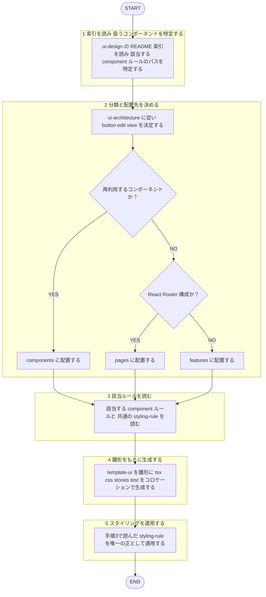

# create-ui-component

役職: **ブッパ**（実装者）。ui-design ルール通り正確に UI を撃ち抜く。

## 概要

`shared-rules/ui-design/` のルールに沿って、新規 UI コンポーネントを生成するタスクスキル。アーキテクチャ分類（button / edit / view）を決め、該当コンポーネントルールと共通スタイリングルールを適用する。

## 手順

遷移は図に従い、判定基準・詳細は下の本文に従う。

### 1. 索引を読み、扱うコンポーネントを特定する

`shared-rules/ui-design/README.md`（索引）を読み、作るものに該当する `component/` ルールのパスを特定する。全ファイルは読み込まない。

### 2. 分類と配置先を決める

`shared-rules/ui-design/architecture/ui-architecture.md` に従い button / edit / view を決定する。配置先は次のとおり。

| 種別 | 配置先 |
|------|--------|
| 再利用するコンポーネント | `components/` |
| 単一画面専用（React Router 構成） | `pages/` |
| 単一画面専用（非 Router 構成） | `features/` |

### 3. 該当ルールを読む

- 該当する `component/<分類>/<name>.md`
- 共通: `styling-rule/color.md` / `styling-rule/space-and-radius.md` / `styling-rule/button-rule.md`（ボタン系のとき）

### 4. 雛形をもとに生成する

`shared-rules/ui-design/component/template-ui.md` を雛形として、tsx / css / stories / test をコロケーション（同一フォルダ）で生成する。既存プロジェクトの構成・命名を読んで合わせる。

### 5. スタイリングを適用する

手順3で読んだ `styling-rule/`（配色・角丸・余白・タップ領域など）を唯一の正として適用する。基準値は本スキルに再掲せず、ルールファイルに従う。

## 出力

- 生成したコンポーネントファイル一式。
- 適用したルール（分類・該当 component ルール・スタイリング）の要約と、参照したルールファイルのパス。
