# openspec-setup

## 概要

作業ディレクトリへ OpenSpec（`@fission-ai/openspec`）導入→`openspec-workflow`（`skills/openspec-workflow/SKILL.md`）で使う前提整備。matagi がマーケットプレイスプラグインとして導入済みのどの作業リポジトリでも、同手順で同内容の `openspec/config.yaml`・ローカル fork スキーマ再現可能にする。

## ルール

- ポインタ = 参照のみ。ルール本文コピーしない（[[externalization-rule]]、`matagi-kaji/shared-rules/rule-externalization/externalization-rule.md`）。
- 本スキル = 導入（セットアップ）のみ担当。導入後ワークフロー進行 = [[openspec-workflow]]（`skills/openspec-workflow/SKILL.md`）に委ねる。
- OpenSpec フェーズ・既存 skill 役割分担、埋め込むポインタ内容 = [[openspec-rule]]（`shared-rules/openspec-integration/openspec-rule.md`）を唯一の正とする。
- OpenSpec 自体の事実（コマンド・config.yaml フィールド等）= [[openspec-overview]]（`documents/reference/spec-driven-development/openspec-overview.md`）参照。

## 手順

```mermaid
flowchart TD
    START(["START"])
    END(["END"])

    subgraph L1["1 CLI の有無を確認する"]
        S1a{"openspec コマンドが使えるか？"}
        S1b["npm view で最新版を確認する"]
        S1c{"npm install の実行が承認されたか？"}
        S1d["npm install でグローバルに導入する"]
        S1a -->|NO| S1b
        S1b --> S1c
        S1c -->|YES| S1d
    end

    subgraph L2["2 既存導入の確認"]
        S2a{"openspec/ が既にあるか？"}
        S2b["不足分を特定し 以降は不足分のみ実施する旨をユーザーに伝える"]
        S2a -->|YES| S2b
    end

    subgraph L3["3 openspec init"]
        S3x{"config.yaml と schema の設定が不足しているか？"}
        S3a["openspec init を実行する"]
        S3x -->|YES| S3a
    end

    subgraph L4["4 生成物の確認"]
        S4a["git status と git diff で生成物を確認する"]
        S4b{".gitignore に生成物のディレクトリが含まれているか？"}
        S4c["追加を提案する"]
        S4a --> S4b
        S4b -->|NO| S4c
    end

    subgraph L5["5 schema のローカル fork"]
        S5x{"schema の Source が project ではないか？"}
        S5a["openspec schema fork でローカルに fork し Source が project であることを確認する"]
        S5x -->|YES| S5a
    end

    subgraph L6["6 テンプレートへポインタを埋め込む"]
        S6x{"テンプレートに matagi の参照ポインタが無いか？"}
        S6a["fork したテンプレートに matagi の参照ポインタを HTML コメントで埋め込む"]
        S6x -->|YES| S6a
    end

    subgraph L7["7 config.yaml を編集する"]
        S7x{"手順3と同じ判定で config.yaml と schema の設定が不足していたか？"}
        S7a["schema context rules operations を編集する"]
        S7x -->|YES| S7a
    end

    subgraph L8["8 CLI 生成スキルの自動起動をブロックする"]
        S8a["settings.json の permissions.deny に apply と archive の CLI 生成スキルを追加する"]
    end

    subgraph L9["9 検証する"]
        S9a["openspec schema validate を実行し成功を確認する"]
    end

    subgraph L10["10 完了報告する"]
        S10a["生成・編集したファイル一覧と次の一手をユーザーに提示する"]
    end

    START --> S1a
    S1a -->|YES| S2a
    S1c -->|NO| END
    S1d --> S2a
    S2a -->|NO| S3x
    S2b --> S3x
    S3a --> S4a
    S3x -->|NO| S4a
    S4b -->|YES| S5x
    S4c --> S5x
    S5a --> S6x
    S5x -->|NO| S6x
    S6a --> S7x
    S6x -->|NO| S7x
    S7a --> S8a
    S7x -->|NO| S8a
    S8a --> S9a
    S9a --> S10a
    S10a --> END

    classDef user fill:#fff3bf,stroke:#f08c00,color:#000
    class S1c,S4c user
```



遷移は図に従い、判定基準・詳細は下の本文に従う。

凡例: 黄 = ユーザーの確認・承認

1. **CLI の有無を確認する** — `openspec --version` 実行。失敗 → `npm view @fission-ai/openspec version` で最新版確認、`npm install -g @fission-ai/openspec@<version>` 実行をユーザーに確認してから実施（グローバル環境への副作用のため）。
2. **既存導入の確認（冪等性）** — 対象ディレクトリに `openspec/` 既存 → 以下で不足分特定、以降手順は不足分のみ実施（フルスクラッチでないことをユーザーに伝える）。
   - `openspec/config.yaml` の有無・`schema: spec-driven` の有無 → 無ければ手順3・7
   - `openspec schema which spec-driven` の `Source` が `project` か → `package` のままなら手順5未実施
   - `openspec/schemas/spec-driven/templates/proposal.md` に `matagi:` を含む HTML コメントあるか（`grep -l "matagi:" openspec/schemas/spec-driven/templates/*.md`） → 無ければ手順6
3. **`openspec init`** — `openspec init --tools claude --profile core` 実行。他ツール使いたい場合のみ `--tools` 変更（ユーザーに確認してから）。
4. **生成物の確認** — `git status`/`git diff` で `.claude/skills/openspec-*`・`.claude/commands/opsx/` の生成確認。`.gitignore` に `.claude/skills/`・`.claude/commands/` 無ければ追加を提案（これらは `openspec init`/`openspec update` のたび再生成される成果物。この kit の管理対象ではない）。
5. **schema のローカル fork** — `openspec schema fork spec-driven spec-driven`（同名ローカル上書き）実行。`openspec schema which spec-driven` で `Source: project` に切り替わったこと確認。
6. **テンプレートへのポインタ埋め込み** — フォークしたテンプレート（`openspec/schemas/spec-driven/templates/{proposal,design,tasks}.md`）に、`<!-- matagi: ... -->` 形式 HTML コメントで参照ポインタを埋め込む(ルール本文コピーしない)。**埋め込む内容 = [[openspec-rule]] §導入 の表を唯一の正とし、本手順に再掲しない**（対象 issue 番号明記が不要な作業ディレクトリでは、`proposal.md` 側のみユーザー確認のうえ省略可）。
7. **`config.yaml` の編集** — `schema`/`context`/`rules`/`operations` を編集。`context`/`rules` = アーティファクトに一切コピーされない AI 向け制約。ここに要点を書いてよい(本文コピーではない)。**書く内容 = 手順6同様 [[openspec-rule]] §導入 の表を唯一の正とする。**
8. **CLI 生成スキルの直接自動起動をブロックする** — `.claude/settings.json`（プロジェクト設定・commit 対象）の `permissions.deny` に以下追加（既存設定は保持してマージ）。理由・位置づけ = 再掲せず [[openspec-rule]] §レビュー独立性 を唯一の正とする。
   ```json
   "permissions": {
     "deny": [
       "Skill(openspec-apply-change *)",
       "Skill(openspec-archive-change *)"
     ]
   }
   ```
9. **検証** — `openspec schema validate spec-driven` 実行、成功確認。
10. **完了報告** — 生成・編集ファイル一覧（`.claude/settings.json` の deny 追加含む）、`.gitignore` への提案、次は [[openspec-workflow]] スキルで進める旨を提示。

## 出力

- 確認フェーズ: 各ステップ実行前確認事項（npm install 要否、`--tools` 選択、`.gitignore` への追加提案）
- 完了フェーズ: 生成・編集ファイル一覧、`openspec schema validate` 結果、次の一手（[[openspec-workflow]] へ）
