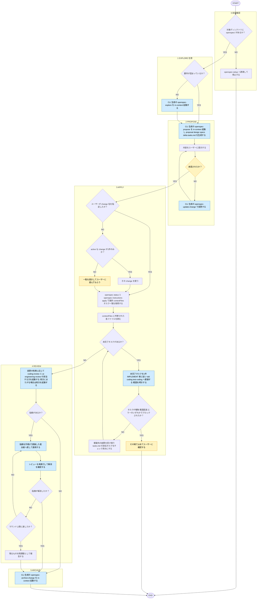

# openspec-workflow

役職: **シカリ**（統括）。spec 合意形成から適用まで指揮。

## 概要

OpenSpec のフェーズ（explore/propose/apply/archive）を統括。CLI 生成の `openspec-apply-change`/`openspec-archive-change` スキルは、この kit の既存ルール（実装は産出 skill へ委譲・レビューと産出者は別エージェント）を知らない。apply/archive では**それらを起動せず**、本スキルが `openspec` CLI を直接叩いて進行・委譲・レビューゲートを担う。explore/propose はコードを書かないため、CLI 生成スキルをそのまま使う。

## ルール

- OpenSpec フェーズと既存フェーズ・skill の役割分担は [[openspec-rule]]（`shared-rules/openspec-integration/openspec-rule.md`）を唯一の正とする。
- レビューと産出者の分離は [[review-independence-rule]]（`matagi-kaji/shared-rules/harness-engineering/review-independence-rule.md`）に従う。apply の産出者と archive 前のレビューは常に別エージェント。
- 実装の委譲先判定は [[github-issue-resolve]]（`skills/github-issue-resolve/SKILL.md`）手順4の IMPLEMENT 表と同基準。委譲先スキルは in-context 起動（スキル起動／エージェント委譲の定義は [[selection-rule]] 参照）。domain 判定と具象サブエージェントへの隔離委譲は各委譲先スキルの責務。
- `openspec/` 未導入なら [[openspec-setup]]（`skills/openspec-setup/SKILL.md`）に委ねる。本スキルでは導入作業をしない。

## 手順

遷移は図に従い、判定基準・詳細は下の本文に従う。

凡例: 黄 = ユーザーの確認・承認、青 = 他スキル・エージェントへの委譲

0. **前提確認** — 対象ディレクトリに `openspec/` が無ければ [[openspec-setup]] へ誘導して停止。

1. **EXPLORE**（任意） — 要件が固まっていなければ、CLI 生成の `openspec-explore` スキルをそのまま in-context 起動（コードを書かないため委譲問題なし）。

2. **PROPOSE** — CLI 生成の `openspec-propose` スキルをそのまま in-context 起動し、proposal/design/specs delta/tasks.md を生成（同上、問題なし）。生成後、内容をユーザーに提示、承認を得てから次へ。変更が必要なら CLI 生成の `openspec-update-change` スキルを使う（コード変更を禁じているため問題なし）。

3. **APPLY** — **CLI 生成の `openspec-apply-change` スキルは起動しない**（実装コードを自分で直接書き、既存の委譲表を無視するため）。代わりに以下を行う。
   - `<name>` の決定: ユーザー指定があればそれを使う。未指定なら会話文脈から推測し、`openspec list --json` で確認できる active な change が1件のみならそれを使う。複数あれば一覧を提示してユーザーに選んでもらう(勝手に決めない)。
   - `openspec status --change "<name>" --json` で進捗・スキーマ・パスを取得。
   - `openspec instructions apply --change "<name>" --json` で `contextFiles`（proposal/specs/design/tasks 等）とタスク一覧を取得。
   - `contextFiles` に列挙された各ファイルを読む。
   - tasks.md の未完了タスク（`- [ ]`）を1件ずつ、[[github-issue-resolve]] の IMPLEMENT 表に従い `tdd`/`coding`/`test-coding` へ委譲（テストを伴う実装は `tdd`、伴わない実装は `coding`、テストのみは `test-coding`）。委譲先に「このタスクの範囲のみ実装する」ことを明示。
   - 委譲先から実装結果を受け取ったら、本スキル自身が該当タスクの `- [ ]` を `- [x]` に更新。
   - タスクが曖昧、実装がタスク・spec の範囲を超える、エラー発生の場合は、その場で範囲を広げず一旦止めてユーザーに確認（黙って narrow/defer しない）。
   - 全タスク完了、またはブロックされるまで繰り返す。

4. **REVIEW**（新規ゲート。CLI 生成のワークフローには無い工程） — 実装コード中心の変更なら `coding-review`、md 資産（rules/skills/AGENTS.md/CLAUDE.md 等）中心なら `ai-engineering-review` を in-context 起動。両方にまたがる変更は両方を起動。指摘の適用は手順3で委譲した産出者へ戻す。**適用後、修正した産出者自身に確認させず、レビューを再実行して解消を確認**（[[review-independence-rule]]: 修正後の再検証も修正した本人に委ねない）。指摘が残る場合はラウンドを繰り返す(最大2ラウンド。それでも残るものは残課題として報告)。**このレビューを経ずに手順5（ARCHIVE）へ進まない。**

5. **ARCHIVE** — レビュー完了後、CLI 生成の `openspec-archive-change` スキルを in-context 起動（この時点ではファイル移動と spec 統合のみのため、CLI 生成のままで問題なし）。

各手順で現フェーズ（EXPLORE/PROPOSE/APPLY/REVIEW/ARCHIVE）を明示。

## 出力

- 現フェーズ、委譲先（入口スキルと判明していれば具象サブエージェント）、進捗（N/M タスク完了）
- APPLY: タスクごとの委譲先と結果
- REVIEW: レビュー結果と指摘の適用状況
- ARCHIVE: アーカイブ結果、specs 同期の有無
