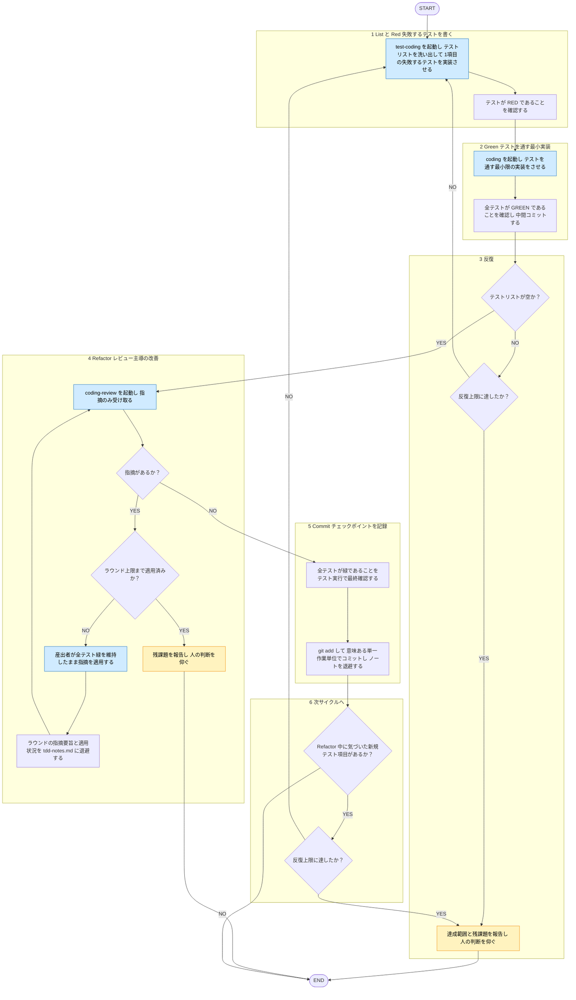

# tdd

役職: **シカリ**（統括）。Red-Green-Refactor サイクル指揮。

## 概要

`tdd-rule` 唯一根拠→TDD 各フェーズ 産出者・レビュアーへ委譲。List/Red/Green/Refactor 全て domain（frontend/backend 等）不問 単一入口スキル（`test-coding` / `coding` / `coding-review`）へ委譲。domain 判定・具象サブエージェント分岐 = 各入口スキル責務。tdd スキル自身 domain 詳細不関与、フェーズ進行統括のみ。指摘適用 = レビュー独立性従い産出者担当。

## ルール

- サイクル（List-Red-Green-Refactor-Commit）・コーディング標準 = [[tdd-rule]]（`shared-rules/coding-conventions/tdd-rule.md`）従う。「Red-Green-Refactor」通称。正確 = List 含む5フェーズ（[[tdd-rule]] §2）。フェーズ飛ばさず、現フェーズ（LIST/RED/GREEN/REFACTOR/COMMIT）常時明示。
- レビュー・修正適用分離 = [[review-independence-rule]] 従う。Refactor レビューも産出者と別エージェント、適用は産出者へ戻す。
- **産出者単一責任**: List/Red = `test-coding` スキル、Green・Refactor 適用 = `coding` スキル責任。各スキル自担当フェーズのみ、他フェーズ産出・自己完結しない。Refactor 実装適用を Green 同 `coding` スキルに揃える理由: レビュー（別エージェント）・適用（産出者）分離（[[review-independence-rule]]）維持＋実装担当産出者一貫のため。
- **隔離（エージェント委譲）理由 2種。混同しない**:
  - **産出フェーズ（List/Red/Green）隔離**: [[selection-rule]]「隔離したい副次タスク」基準。テスト・実装試行錯誤→メイン会話汚染しやすいため`test-coding` / `coding` スキル in-context 起動、実コード生成は domain 判定後 専用（または汎用）サブエージェントへ隔離委譲（[[domain-classification-rule]]）。最終実装・テストコード結果のみ確認、生成過程逐次可視性は不要、という判断（issue #17 で明示承認済み）。
  - **Refactor フェーズ隔離**: [[review-independence-rule]] 基準。産出者本人 自作物の甘さ・盲点あり→産出者と別エージェントがレビュー。理由 =「メイン汚染」でなく「自己評価不信頼」。
  - 両者理由別。一方説明を他方へ流用しない。
- **委譲種別**: スキル起動／エージェント委譲定義 = [[selection-rule]] 参照（再掲しない）。`test-coding` / `coding` / `coding-review` 全て tdd から in-context 起動。各スキル内部 domain 判定後 具象（または汎用）サブエージェントへ隔離委譲。
- **反復上限**: 1機能あたり最大 3 サイクル目安（サイクル・周の定義 = [[tdd-rule]] §2「Refactor の実施粒度」）。3 サイクルで緑にならない／未解決残る→サイクル続けず、達成範囲・残課題報告→人の判断を仰ぐ。対話中遵守の目安、ハーネス強制ではない（暴走 = メインスレッドで可視・中断可能）。上限確実強制したい場合のみ、commit 捕捉 hook を別途用意。
- **Refactor 実施粒度**: Red-Green と別、まとめて1回のみ（詳細・理由 = [[tdd-rule]] §2「Refactor の実施粒度」参照。再掲しない）。
- **Refactor 停止条件**: 対象が1issue全体に拡大するため、レビュー→適用は複数ラウンド許容、無制限には反復しない。**最大 5 ラウンド**目安、途中で指摘収束→打ち切り。5 ラウンド到達でも未収束→反復続けず、残課題報告→人の判断を仰ぐ。反復上限同様、対話中遵守の目安・ハーネス強制ではない。各ラウンド境界で、指摘要旨・適用状況（適用済み／未適用）を `tdd-notes.md` に数行退避→次ラウンドへ（ルール「サイクルをまたぐ記憶」）。
- **サイクルをまたぐ記憶**: 決定・未解決事項・次サイクル狙い→スクラッチパッド `tdd-notes.md` に数行退避、次サイクル冒頭で読み直し（[[long-horizon-rule]]）。
- 規約具体値再掲せず、上記ルール唯一の正として参照（[[externalization-rule]]）。

## 手順

遷移は図に従い、判定基準・詳細は下の本文に従う。

凡例: 黄 = ユーザーの確認・承認、青 = 他スキル・エージェントへの委譲

1. **List — テストリストを洗い出す** / **Red — 失敗するテストを書く**
   - `test-coding` スキル in-context 起動。同スキル 検証すべき振る舞いシナリオ洗い出し（List。[[tdd-rule]] Phase 0）→リストから1項目選択→失敗テスト実装（Red。[[tdd-rule]] Phase 1）。「失敗テストのみ実装、実装コード書かない」明示。Red 実装段階 同スキル内部 domain 判定後 対応サブエージェント（例: `frontend-tester` / `backend-tester`、専用無し domain = 汎用サブエージェント）へ隔離委譲（[[domain-classification-rule]]）。テスト RED 確認。
2. **Green — テストを通す最小実装**
   - `coding` スキル in-context 起動。テスト = Red で用意済み→実装のみ。同スキル内部 domain 判定後 対応サブエージェント（例: `frontend-coder` / `backend-coder`、専用無し domain = 汎用サブエージェント）へ隔離委譲（[[domain-classification-rule]]）。テストを通す最小限のみ、余分機能足さない。全テスト GREEN 確認後、即中間コミット（ルール「Refactor の実施粒度」）。
3. **反復** — テストリスト空まで 手順1〜2（List/Red → Green）反復（[[tdd-rule]] Phase 4）。反復上限（ルール「反復上限」）未到達→リスト次項目で手順1へ戻る。Refactor はこの反復に含めない。
4. **Refactor — レビュー主導の改善（緑維持、テストリスト全項目完了後まとめて1回）**
   - `coding-review` スキル in-context 起動。同スキル内部 domain 判定後 コーディング規約・テスト規約（frontend = 追加で UI デザイン）観点で該当レビューサブエージェントへ隔離委譲、指摘のみ返る。指摘受領→産出者（Green 同 `coding` スキル委譲実装）が全テスト緑維持のまま適用。レビュー→適用 複数ラウンド許容、**最大5ラウンドで打ち切り**（ルール「Refactor の停止条件」）。指摘収束まで、または5ラウンド到達まで反復。
5. **Commit — チェックポイントを記録**
   - 全テスト緑 最終確認（テスト実行で担保。[[review-independence-rule]]: 再検証も産出本人に委ねない）→ `git add` → 意味ある単一作業単位でコミット。手順2中間コミットと別、Refactor 適用分をこのコミットに含める。サイクルノート退避（ルール「サイクルをまたぐ記憶」）実施。
6. **次サイクルへ** — Refactor 中に気づいた新規テスト項目あり＋リスト非空（[[tdd-rule]] Phase 3「Refactor 中の新規項目」）、反復上限（ルール「反復上限」）未到達→次サイクル手順1（List/Red）へ戻る。上限到達→ルール従い終了。

## 出力

- 現フェーズ（LIST/RED/GREEN/REFACTOR/COMMIT）、委譲先（入口スキル＋判明していれば内部分岐した具象サブエージェント）と結果、テスト緑/赤状態、コミット単位（中間コミット／Refactor 後コミットの別）、サイクル番号（例: 2 サイクル目）
