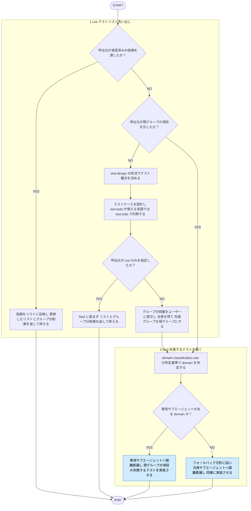

# test-coding

役職: **ブッパ**（実装者）。失敗するテストを狙い通り撃ち抜く。

## 概要

TDD **List（テストリスト洗い出し）・Red（失敗するテストを書く）** 両フェーズ担当スキル（[[tdd-rule]] Phase 0-1）。テスト観点洗い出し→抜け漏れないテストケース設計（List 相当）。その上で対象コード分析、domain 判定→対応専門サブエージェント（`frontend-tester` / `backend-tester` 等）へ失敗するテストコード実装（Red 相当）を委譲。呼出元から言語・domain に依存しない単一入口として使える。

## ルール

- テスト観点洗い出し技法 = [[test-design]] (`shared-rules/test-design/test-design.md`) 参照。List フェーズに実装設計判断を混ぜない（[[tdd-rule]] Phase 0 条件）。テストリスト固定でなく、作業中に気づいた項目を随時追加してよい。
- TDD List/Red フェーズ考え方・コーディング標準 = [[tdd-rule]] (`shared-rules/coding-conventions/tdd-rule.md`) 従う。本スキル = List・Red フェーズ担当、失敗するテストコード実装まで行う。プロダクションコード実装は行わない。
- テスト項目抜け漏れ防止重視。`test.todo` 使える言語ではこれを用い、未実装テスト項目を可視化。
- domain 判定基準・対応サブエージェント・専用サブエージェント不在時委譲方針 = [[domain-classification-rule]] (`shared-rules/coding-conventions/domain-classification-rule.md`) を唯一の正とする。本スキルに再掲しない。
- テストコード実装 = [[design-rule]] (`shared-rules/design-principles/design-rule.md`) 設計原則（DRY/SRP/SoC等）従う。
- 対象物 = テストコード。テスト仕様書（ドキュメント）作成は行わない。
- 本スキル = List/Red フェーズ産出に専念、レビューは行わない。内蔵レビュー（`test-design-reviewer`・`design-principles-reviewer` への委譲）は廃止し、コード・テストのレビューは tdd-workflow の Refactor フェーズ（`coding-review` 経由）に集約（[[tdd-rule]] Phase 3、issue #39）。
- 例外 = `test-design-reviewer` のみ、List 後の簡易チェックとして tdd-workflow が起動する（[[tdd-rule]] Phase 0）。本スキルからは起動しない。両エージェントとも単独起動は可能。

## 手順

遷移は図に従い、判定基準・詳細は下の本文に従う。

凡例: 青 = 他スキル・エージェントへの委譲

### List（テストリスト洗い出し）

1. **承認済み指摘の反映** — 呼出元が現リストと承認済みの指摘（[[tdd-rule]] Phase 0 の簡易チェック）を渡した場合 = リストに反映し、更新したリストとグループ分割案を返して終える（以降の手順は行わない）。
2. **現グループの有無を確認する** — 呼出元が現グループ（形式 = `グループ名: 項目一覧`）を示した場合 = List を再生成せず Red（domain 判定）へ。グループの定義・分割の合意 = [[tdd-rule]] §2「Red-Green（Phase 1-2）の実施粒度」。tdd-workflow 経由では呼出元がユーザーと合意を取る。
3. テスト観点を決める（[[test-design]] 技法を参照する）。呼出元が完了済み項目を渡した場合 = それを除いた未完了・新規項目のみを扱う。
4. テストケースを設計する（`test.todo` 使える言語では `test.todo` で列挙する）
5. **List のみ指定の扱い** — 呼出元が「List のみ」を指定した場合 = Red に進まず、リストとグループ分割案（形式 = `グループ名: 項目一覧`）を返して終える。
6. **単独起動の扱い** — 指定がなく現グループも示されていない場合 = グループ分割案をユーザーに提示して合意を得てから、先頭グループで Red へ。

### Red（失敗するテストを書く）

7. **domain を判定する** — [[domain-classification-rule]] 判定基準従う。
8. **失敗するテストコードを実装する（RED）**（隔離起動） — [[domain-classification-rule]] 対応表従い、frontend/backend = 専用サブエージェントへ、専用サブエージェント無い domain = 同ルールフォールバック方針従い汎用サブエージェントへ委譲。実装範囲 = 現グループ（[[tdd-rule]] §2 の制約に従う）。

## 出力

失敗するテストコード（RED 状態。`test.todo` 含む場合はそれも含む）。判定 domain・委譲先。「List のみ」指定で終えた場合 = リストとグループ分割案（`グループ名: 項目一覧`）
