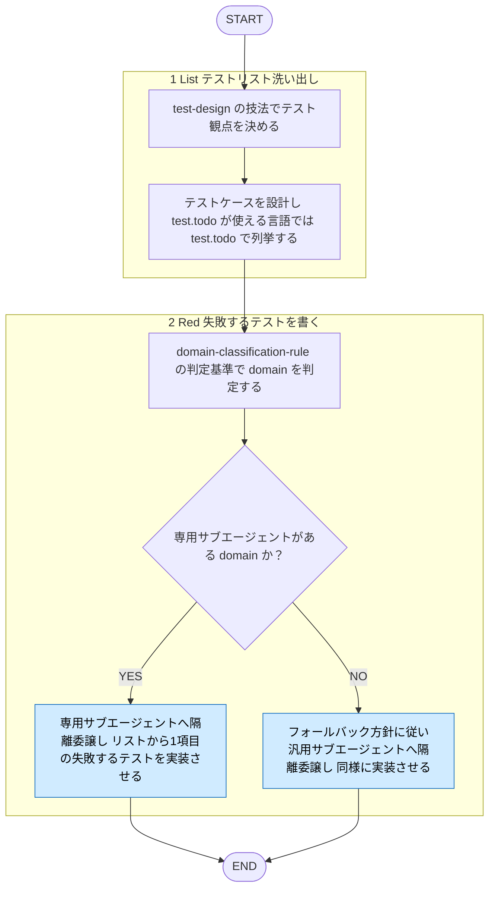

# test-coding

役職: **ブッパ**（実装者）。失敗するテストを狙い通り撃ち抜く。

## 概要

TDD の **List（テストリスト洗い出し）と Red（失敗するテストを書く）** 両フェーズを担うスキル（[[tdd-rule]] Phase 0-1）。テスト観点を洗い出し、抜け漏れのないテストケースを設計（List 相当）。その上で対象コードを分析、domain 判定し、対応する専門サブエージェント（`frontend-tester` / `backend-tester` 等）へ失敗するテストコードの実装（Red 相当）を委譲。呼び出し元からは言語・domain に依存しない単一入口として使える。

## ルール

- テスト観点の洗い出し技法は [[test-design]] (`shared-rules/test-design/test-design.md`) 参照。List フェーズに実装設計判断を混ぜない（[[tdd-rule]] Phase 0 の条件）。テストリストは固定でなく、作業中に気づいた項目を随時追加してよい。
- TDD List/Red フェーズの考え方・コーディング標準は [[tdd-rule]] (`shared-rules/coding-conventions/tdd-rule.md`) に従う。本スキルは List・Red フェーズを担い、失敗するテストコードの実装まで行う。プロダクションコードの実装は行わない。
- テスト項目の抜け漏れ防止を重視。`test.todo` が使える言語ではこれを用い、未実装のテスト項目を可視化。
- domain 判定基準・対応サブエージェント・専用サブエージェント不在時の委譲方針は [[domain-classification-rule]] (`shared-rules/coding-conventions/domain-classification-rule.md`) を唯一の正とする。本スキルに再掲しない。
- テストコードの実装は [[design-rule]] (`shared-rules/design-principles/design-rule.md`) の設計原則（DRY/SRP/SoC等）に従う。
- 対象物はテストコード。テスト仕様書（ドキュメント）の作成は行わない。
- 本スキルは List/Red フェーズの産出に専念、レビューは行わない。TDD サイクル中のレビューは tdd スキルの Refactor フェーズ（`coding-review` 経由のコーディング規約・テスト規約レビュー）に一本化（[[tdd-rule]] Phase 3、issue #39）。`test-design-reviewer`（テスト観点・ケースの抜け漏れ）・`design-principles-reviewer`（設計原則）は本スキルからの委譲を廃止。両者はエージェントとして独立起動可能なまま残すが、TDD サイクルからは呼ばれない。

## 手順

遷移は図に従い、判定基準・詳細は下の本文に従う。

凡例: 青 = 他スキル・エージェントへの委譲

### List（テストリスト洗い出し）

1. テスト観点を決める（[[test-design]] の技法を参照する）
2. テストケースを設計する（`test.todo` が使える言語では `test.todo` で列挙する）

### Red（失敗するテストを書く）

3. **domain を判定する** — [[domain-classification-rule]] の判定基準に従う。
4. **失敗するテストコードを実装する（RED）**（隔離起動） — [[domain-classification-rule]] の対応表に従い、frontend/backend なら専用サブエージェントへ、専用サブエージェントが無い domain なら同ルールのフォールバック方針に従い汎用サブエージェントへ委譲する。リストから1項目だけを選んで実装する（[[tdd-rule]] Phase 1 の禁止事項に従う）。

## 出力

失敗するテストコード（RED 状態。`test.todo` を含む場合はそれも含む）。判定した domain と委譲先
