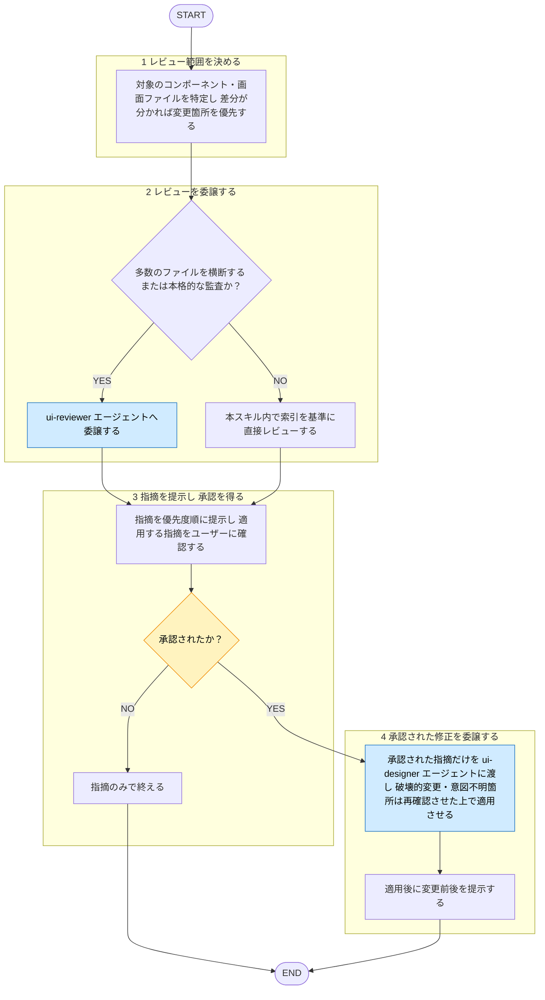

# ui-review

役職: **オキテ**（検証者）。ui-design ルール逸脱見逃さぬ。

## 概要

UI 実装レビュー**入口・承認ゲート**となるタスクスキル。`shared-rules/ui-design/` に照らした監査 = `ui-reviewer` エージェントへ委譲、違反・逸脱を Critical / Warning / Suggestion で提示。修正は勝手に適用せず、**人の承認取得後に** `ui-designer`（修正適用専用）へ適用委譲。レビュワーと産出者は別エージェント（[[review-independence-rule]]）。指摘だけで終える依頼にも対応。

作者への忖度を排し、逸脱は率直に指摘。

## 手順

遷移は図に従い、判定基準・詳細は下の本文に従う。

凡例: 黄 = ユーザーの確認・承認、青 = 他スキル・エージェントへの委譲

### 1. レビュー範囲を決める

対象コンポーネント・画面ファイル特定。差分分かれば変更箇所優先。

### 2. レビューを委譲する

- **多数ファイル横断／本格的監査**: `ui-reviewer` エージェントへ委譲。重い ui-design ルールを隔離コンテキストで読み、所見を構造化して返す役割。
- **単一コンポーネント・少量差分**: 本スキル内で直接レビューしてよい。その場合も基準は `shared-rules/ui-design/README.md`（索引）に置き、必要ルールのみ読む（全ファイルは読まない）。

エージェントへ「レビュー対象ファイル／差分」「指摘のみ・修正は適用しない」旨を渡す。

### 3. 指摘を提示し、承認を得る

返ってきた指摘を優先度順に提示。修正まで望むか（どの指摘を適用するか）ユーザーに確認。承認得られなければ指摘のみで終える。

### 4. 承認された修正を委譲する

承認された指摘のみ `ui-designer` エージェント（修正適用専用）に渡して適用させる。破壊的変更・意図不明箇所 = エージェント側で再確認させる。適用後 変更前後を提示。

## 出力

- **指摘**: 優先度（Critical / Warning / Suggestion）ごと整理して返す。3段階定義 = [[severity-rule]]（`shared-rules/review-severity/severity-rule.md`）従う。このドメイン Critical 該当例: ユーザー体験・アクセシビリティを損なう重大な逸脱、または明確なルール違反。

  各項目 = `file:line` ／ 違反規約（根拠ルールパス）／ 問題点 ／ 修正の方向性 の形。違反なし → 「ui-design ルール準拠で問題なし」明記。

- **適用結果**（承認された場合のみ）: `ui-designer` 適用編集・適用後コード。
